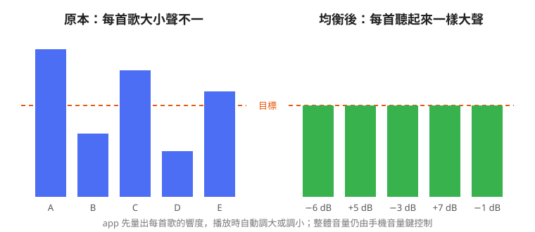
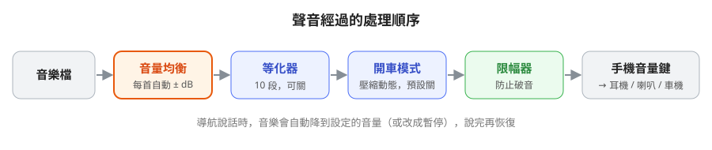

# 均衡播放器

Android 本機音樂播放器。自動平衡每首歌的音量，切歌不再忽大忽小。

## 安裝

1. 下載 [`release/MusicBalance-1.0.0-arm64.apk`](release/MusicBalance-1.0.0-arm64.apk)，傳到手機。
2. 點開安裝，依提示允許「安裝不明來源應用程式」。
3. 開啟 app，允許「音樂和音訊」與「通知」權限。

## 功能

- **音量均衡**：自動量測每首歌響度並調整，音量鍵照常控制整體大小聲
- **音樂庫**：歌曲 / 專輯 / 歌手 / 資料夾瀏覽、搜尋、排序、封面
- **播放**：播放清單、我的最愛、隨機、循環、待播清單、記住播放位置
- **背景**：通知列與鎖定畫面控制、耳機按鍵、拔耳機自動暫停
- **導航**：導航說話時自動降低音量或暫停
- **音效**：10 段等化器、開車模式
- **其他**：深色模式、桌面小工具、Android Auto、中 / 英文

## 限制

- 僅支援 Android 8.0 以上的 64 位元手機
- 僅播放手機內的音樂檔，不支援串流
- 未上架 Play 商店，需手動安裝
- 首次使用需在背景分析響度，每首約 3 秒
- 預設隱藏 30 秒以下的音檔
- 含 `.nomedia` 的資料夾不會被掃描
- Android Auto 需在 Android Auto 開發人員設定中開啟「不明來源」
